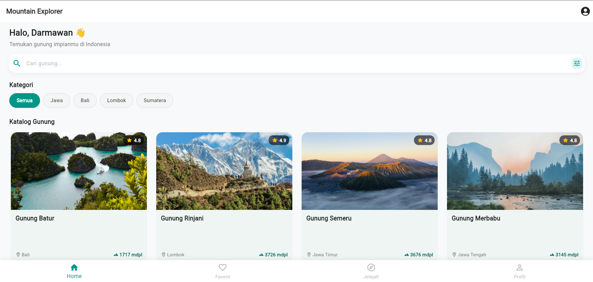

# mountain_explorer

A new Flutter project.

## Getting Started

This project is a starting point for a Flutter application.

A few resources to get you started if this is your first Flutter project:

- [Learn Flutter](https://docs.flutter.dev/get-started/learn-flutter)
- [Write your first Flutter app](https://docs.flutter.dev/get-started/codelab)
- [Flutter learning resources](https://docs.flutter.dev/reference/learning-resources)

For help getting started with Flutter development, view the
[online documentation](https://docs.flutter.dev/), which offers tutorials,
samples, guidance on mobile development, and a full API reference.

```markdown

# Mountain Explorer 🏔️

Aplikasi mobile berbasis Flutter yang dirancang untuk eksplorasi katalog pegunungan di Indonesia serta manajemen rencana pendakian secara interaktif. Aplikasi ini dibangun sebagai pemenuhan Ujian Tengah Semester (UTS) mata kuliah Pemrograman Mobile.

---

## 👨‍💻 Identitas Pengembang
- **Nama**: I Ketut Darmawan Wirakusuma
- **NIM**: 2415051021
- **Kelas**: PTI 5B

---

## 🚀 Daftar Fitur

### 1. Katalog Gunung (REST API Integration)
- Menampilkan daftar gunung di Indonesia secara dinamis dari REST API kustom.
- Filter wilayah interaktif (Semua, Jawa, Bali, Lombok, Sumatera).
- Fitur pencarian instan nama gunung beserta tombol reset filter.

### 2. Detail Gunung & Bookmark Favorit
- Menampilkan informasi lengkap: elevasi (mdpl), lokasi, tingkat kesulitan, estimasi durasi, dan deskripsi jalur.
- Simpan atau tandai gunung favorit dengan *state management* `Provider` dan umpan balik visual *Floating SnackBar*.

### 3. Manajemen Rencana Pendakian (Full Database CRUD via Supabase)
- **Create**: Formulir pembuatan jadwal pendakian baru dengan validasi tanggal, status, dan catatan rombongan.
- **Read**: Menampilkan daftar rencana pendakian aktif secara *real-time* dari cloud database.
- **Update**: Mengubah data rencana pendakian (tanggal target, status pendakian, dan catatan).
- **Delete**: Membatalkan atau menghapus rencana pendakian dilengkapi *Confirmation Dialog* sebelum proses eksekusi.

### 4. User Feedback & State Handling
- **Loading State**: Animasi putar (*CircularProgressIndicator*) saat sinkronisasi data berlangsung.
- **Error State**: Tampilan visual saat koneksi gagal atau terputus disertai tombol **Coba Lagi** (*Retry*).
- **Empty State**: Tampilan ilustrasi ramah ketika hasil pencarian atau daftar rencana kosong.
- **Gesture Pull-to-Refresh**: Memperbarui data katalog dan jadwal dengan menarik layar ke bawah.

### 5. Responsif & UI Adaptif
- Menggunakan `LayoutBuilder` untuk tata letak dinamis (1 kolom di mobile hingga 4 kolom di layar lebar/desktop) tanpa *overflow*.

---

## 🛠️ Tech Stack

- **Framework**: Flutter (Channel Stable)
- **Bahasa Pemrograman**: Dart
- **State Management**: Provider (`provider`)
- **Konektivitas & Backend**: `http`, `supabase_flutter`
- **Arsitektur**: Model-View-Provider-Repository-Service (Separation of Concerns)

---

## 🌐 REST API yang Digunakan

Data katalog gunung bersumber dari REST API kustom yang dibuat sendiri dan di-host langsung pada repositori GitHub pribadi:

- **Author / Host**: I Ketut Darmawan Wirakusuma
- **Endpoint URL**: `https://raw.githubusercontent.com/Darmaxfubuki/rest-api/refs/heads/main/mountains.json`
- **Metode HTTP**: `GET`
- **Format Data**: JSON (*JavaScript Object Notation*)
- **Contoh Format Respons**:
```json
[
  {
    "id": 1,
    "name": "Gunung Batur",
    "location": "Bali",
    "elevation": 1717,
    "rating": 4.8,
    "difficulty": "Mudah",
    "estimated_time": "2 - 3 Jam",
    "image_url": "[https://images.unsplash.com/photo-1544735716-392fe2489ffa](https://images.unsplash.com/photo-1544735716-392fe2489ffa)",
    "description": "Gunung berapi aktif di Kintamani..."
  }
]

```

---

## 🗄️ Backend/Database yang Digunakan

Aplikasi mengintegrasikan database cloud **Supabase** (PostgreSQL) untuk menyimpan data rencana pendakian secara persisten:

* **Platform Backend**: Supabase
* **Database Engine**: PostgreSQL
* **Nama Tabel**: `plans`
* **Struktur Kolom Database**:
* `id`: UUID (Primary Key, default: `gen_random_uuid()`)
* `mountain_name`: Text (Nama gunung tujuan)
* `target_date`: Date / Timestamp (Target tanggal pendakian)
* `status`: Text (Status rencana: Rencana / Berjalan / Selesai)
* `notes`: Text (Catatan perlengkapan / logistik rombongan)
* `created_at`: Timestamp (Waktu pencatatan data)


---

## 🏛️ Struktur Arsitektur Aplikasi

Proyek menerapkan prinsip pemisahan tanggung jawab (*Separation of Concerns*) dengan struktur direktori sebagai berikut:

```text
lib/
├── core/
│   └── constants/               # Konstanta global, konfigurasi teks, dan tema aplikasi
├── models/
│   ├── mountain_model.dart      # Model parsing data JSON dari REST API
│   └── plan_model.dart          # Model mapping data tabel database Supabase
├── providers/
│   ├── mountain_provider.dart   # State management untuk filter, search, & favorit katalog
│   └── plan_provider.dart       # State management untuk operasi CRUD rencana pendakian
├── repositories/
│   └── mountain_repository.dart # Abstraksi penghubung data layer dengan UI
├── services/
│   ├── mountain_api_service.dart# Logic koneksi HTTP ke REST API GitHub
│   └── plan_service.dart        # Service interaksi query database Supabase
├── screens/
│   ├── home/                    # Tampilan katalog utama & pencarian
│   ├── mountain/                # Tampilan detail gunung & daftar favorit
│   ├── adventure/               # Tampilan daftar rencana pendakian (Read & Delete)
│   ├── plan/                    # Tampilan formulir Create & Edit rencana pendakian
│   └── profile/                 # Tampilan profil pengembang & informasi aplikasi
└── widgets/
    ├── bottom_nav.dart          # Bottom Navigation Bar adaptif
    ├── category_chip.dart       # Komponen chip filter wilayah
    ├── mountain_card.dart       # Komponen kartu katalog responsif
    └── search_bar_widget.dart   # Komponen input search bar

```

---

## 📸 Screenshot Aplikasi



---

## ⚙️ Cara Menjalankan Project

### 1. Clone Repositori

* Buka terminal di komputer Anda, lalu jalankan perintah:

```bash
git clone https://github.com/Darmaxfubuki/UTS_2415051021_I-Ketut-Darmawan-Wirakusuma.git
cd mountain_explorer

```

### 2. Unduh Dependensi

* Pasang semua dependensi proyek dengan menjalankan:

```bash
flutter pub get

```

### 3. Konfigurasi Database Supabase

* Pastikan inisialisasi kredensial URL dan Anon Key Supabase sudah terpasang pada file `lib/main.dart`:

```dart
await Supabase.initialize(
  url: 'https://vpkmycnfgpxqqfvalajv.supabase.co',
  anonKey: 'sb_publishable_kzKap6eBMh0bhutnrT9_vQ_nqoN1eRU',
);

```

### 4. Jalankan Aplikasi

* **Menjalankan pada Browser (Chrome)**:

```bash
flutter run -d chrome

```

* **Menjalankan pada Android Emulator atau Device Fisik**:

```bash
flutter run

```

```

```